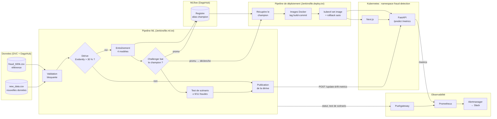
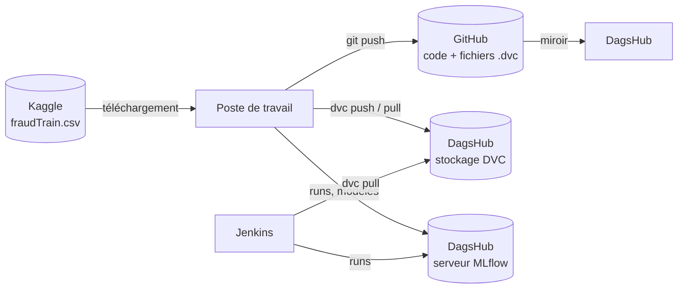
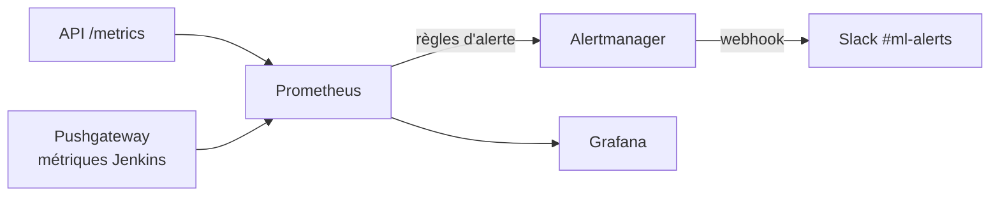

# 🛡️ Détection de fraude bancaire — plateforme MLOps

[](https://fastapi.tiangolo.com/)
[](https://nextjs.org/)
[](https://dvc.org/)
[](https://mlflow.org/)
[](https://www.jenkins.io/)
[](https://kubernetes.io/)
[](https://prometheus.io/)
[](https://www.evidentlyai.com/)

Plateforme de bout en bout pour **détecter les transactions frauduleuses sur cartes bancaires** :
données versionnées avec DVC, expériences suivies dans MLflow, ré-entraînement déclenché par la
dérive des données, promotion contrôlée du modèle (champion / challenger), déploiement sur
Kubernetes et supervision par Prometheus.

Le dépôt sert aussi de fil rouge au **cours MLOps** dont le support compilé est
[`slides/main.pdf`](slides/main.pdf) (Beamer, 14 sections, 194 pages).

---

## Sommaire

1. [Architecture](#️-architecture)
2. [Démarrage rapide](#-démarrage-rapide)
3. [**Guide complet : installer, configurer, exécuter**](#-guide-complet)
4. [Structure du dépôt](#-structure-du-dépôt)
5. [Cycle de vie du modèle](#-cycle-de-vie-du-modèle)
6. [API](#-api)
7. [Monitoring et alertes](#-monitoring-et-alertes)
8. [Déploiement Kubernetes (aide-mémoire)](#️-déploiement-kubernetes-aide-mémoire)
9. [Sécurité](#-sécurité)
10. [Configuration (référence des variables)](#️-configuration-référence-des-variables)
11. [Limites connues](#️-limites-connues)
12. [Améliorations de cette version](#-améliorations-de-cette-version)

---

## 🏗️ Architecture



Trois flux à retenir :

* **Données → modèle** : la dérive déclenche l'entraînement, mais un nouveau modèle n'est promu
  que s'il bat le champion, puis seulement s'il passe le test de scénario.
* **Modèle → production** : le pipeline de déploiement prend le modèle dans le **registre MLflow**
  (alias `champion`), pas dans un fichier local, et produit des images au tag immuable.
* **Production → supervision** : l'API expose ses métriques à Prometheus ; les résultats de CI
  passent par le Pushgateway ; Alertmanager prévient sur Slack.

---

## 🚀 Démarrage rapide

Le dépôt ne contient **ni données, ni modèle** : la première fois, tout est produit à partir
du jeu de données Kaggle par les notebooks ([étape 7](#7-produire-les-données-et-le-modèle-notebooks)) ;
ensuite, `dvc pull` le restaure.

**Essai local, sans compte** (MLflow enregistre dans `mlflow.db`) :

```bash
python3.12 -m venv .venv && source .venv/bin/activate
pip install -r requirements.txt jupyterlab
cp .env.example .env                          # vider MLFLOW_TRACKING_URI ; QUICK_RUN=1 pour aller vite
# fraudTrain.csv (Kaggle) -> data/raws/fraud_1M.csv : voir l'étape 7.1
jupyter lab notebooks/                        # exécuter 01 -> 02 -> 03 -> 04
docker compose up -d --build                  # http://localhost:3000
```

**Données et modèle déjà versionnés sur DagsHub** (par exemple sur un nouveau poste,
détails aux [étapes 4 et 5](#4-connecter-dagshub-et-créer-le-fichier-env)) :

```bash
python3.12 -m venv .venv && source .venv/bin/activate
pip install -r requirements.txt
cp .env.example .env                          # compléter DAGSHUB_* et MLFLOW_*
dvc remote modify origin url https://dagshub.com/<utilisateur-dagshub>/<depot-dagshub>.dvc
dvc remote modify origin --local auth basic
dvc remote modify origin --local user <utilisateur-dagshub>
dvc remote modify origin --local password <token-dagshub>
dvc pull artifacts/preprocessing/ artifacts/mlflow/Best_Fraud_LightGBM/
docker compose up -d --build                  # http://localhost:3000
```

> Les valeurs entre `<…>` (comptes DagsHub et Docker Hub) sont **à compléter** : le dépôt n'en
> contient aucune par défaut. Liste des fichiers concernés : [étape 13.4](#13-installer-jenkins-et-les-deux-pipelines).

---

## 📘 Guide complet

Ce guide va de zéro à la boucle MLOps complète : dépôt GitHub, DagsHub, DVC, MLflow, notebooks,
API locale, Kubernetes, Jenkins. Toutes les commandes se lancent **depuis la racine du dépôt**.

Conventions : `<user>` = votre identifiant DagsHub (identique à GitHub si vous vous connectez à
DagsHub avec GitHub), `<repo>` = nom du dépôt, `<token>` = token DagsHub,
`<compte-dockerhub>` = compte Docker Hub.

| Je veux… | Étapes |
|---|---|
| **mettre en place le projet** (dépôt, données et modèle produits de zéro) | [1](#1-installer-les-outils-et-créer-les-comptes) → [2](#2-créer-lenvironnement-python-et-installer-les-dépendances) → [3](#3-créer-le-dépôt-github) → [4](#4-connecter-dagshub-et-créer-le-fichier-env) → [5](#5-configurer-dvc) → [6](#6-configurer-mlflow) → [7](#7-produire-les-données-et-le-modèle-notebooks) |
| tester (pytest, test de scénario, Deepchecks) | 1 → 7, puis [8](#8-tester--pytest-test-de-scénario-deepchecks) |
| tester l'API et l'interface sur mon poste | 1 → 8, puis [9](#9-lancer-et-vérifier-en-local) |
| mesurer la dérive avec Evidently | 1 → 9, puis [10](#10-détecter-la-dérive-des-données-avec-evidently-en-local) |
| déployer sur Kubernetes, superviser, alerter sur Slack | 1 → 10, puis [11](#11-déployer-sur-kubernetes) → [12](#12-monitoring-et-alertes--prometheus-grafana-alertmanager-slack) |
| faire tourner la boucle MLOps complète (dérive → ré-entraînement → déploiement) | 1 → 12, puis [13](#13-installer-jenkins-et-les-deux-pipelines) → [14](#14-démonstration-de-bout-en-bout) |
| exploiter, revenir en arrière, nettoyer | [15](#15-exploitation-au-quotidien), [16 Dépannage](#16-dépannage) |

### 0. Qui stocke quoi

GitHub ne peut héberger ni des données de plusieurs gigaoctets (refus au-delà de 100 Mo par
fichier) ni un serveur MLflow. On lui associe **DagsHub**, qui se connecte à un dépôt GitHub et
fournit gratuitement un remote DVC et un serveur MLflow.

| Emplacement | Contenu | Versionné par |
|---|---|---|
| **GitHub** | code, notebooks (sans sorties), `.dvc/config` ; `data.dvc` et `artifacts.dvc` après le premier `dvc add` (étape 7.2) | Git |
| **DagsHub — stockage DVC** `https://dagshub.com/<user>/<repo>.dvc` | `data/` (CSV), `artifacts/` (processeurs, modèles, figures), ≈ 2,3 Go | DVC |
| **DagsHub — serveur MLflow** `https://dagshub.com/<user>/<repo>.mlflow` | runs, métriques, modèles, Model Registry | MLflow |
| **Votre machine uniquement** | `.env` (tokens), `.dvc/config.local` (identifiants DVC), cache DVC | rien (ignoré par Git) |



`data.dvc` (ou `artifacts.dvc`) est un petit fichier texte contenant le hash `md5` du dossier :
Git versionne ce hash, DVC stocke le contenu correspondant sur le remote. Un commit Git désigne
donc à la fois une version du code **et** une version exacte des données. Ces deux fichiers
n'existent pas dans un dépôt neuf : c'est `dvc add` qui les crée (étape 7.2).

### 1. Installer les outils et créer les comptes

| Outil | Version | Utilisé pour | Dès l'étape |
|---|---|---|---|
| Git (+ CLI GitHub `gh`, facultative) | récente | tout | 3 |
| Python | **3.12** (3.11 accepté) | notebooks, API, tests, scripts Jenkins | 2 |
| Node.js | 18 ou plus | frontend hors Docker | 9 |
| Docker + Docker Compose v2 | récente | `docker compose`, images, conteneur Jenkins | 9 |
| minikube, kubectl, Helm 3 | récentes | Kubernetes et supervision | 11 |
| Python 3.10 | — | environnement séparé de Deepchecks (macOS : `brew install python@3.10`) | 8 |
| `envsubst` | — | configuration d'Alertmanager (macOS : `brew install gettext`) | 12 |

```bash
git --version && python3.12 --version
brew install libomp            # macOS : OpenMP, requis par LightGBM et XGBoost
brew install gh                # facultatif : création du dépôt GitHub en ligne de commande
```

Prévoir environ **5 Go** libres (données, artefacts, cache DVC).

| Compte | Pour | Dès l'étape |
|---|---|---|
| **GitHub** | code | 3 |
| **DagsHub** (*Sign in with GitHub*, le plus simple) | stockage DVC, serveur MLflow | 4 |
| **Kaggle** | données sources | 7 |
| **Docker Hub** | images | 11 |
| **Slack** (facultatif) | webhook d'alertes | 12 |

### 2. Créer l'environnement Python et installer les dépendances

Toutes les commandes Python du projet (notebooks, DVC, MLflow, tests, API) s'exécutent dans un
environnement virtuel `.venv`, à la racine du dépôt (ignoré par Git).

1. Se placer à la racine du projet et créer l'environnement :

   ```bash
   cd ~/Desktop/cours-mlops            # adapter au chemin de votre dossier
   python3.12 -m venv .venv
   ```

2. L'activer (**à refaire dans chaque nouveau terminal**) :

   ```bash
   source .venv/bin/activate           # Windows : .venv\Scripts\activate
   which python                        # doit afficher …/cours-mlops/.venv/bin/python
   python --version                    # Python 3.12.x
   ```

   L'invite du terminal commence alors par `(.venv)`. Pour en sortir : `deactivate`.

3. Installer les dépendances :

   ```bash
   pip install --upgrade pip
   pip install -r requirements.txt     # ML, API, MLflow, DVC, pytest, ipykernel
   pip install jupyterlab nbstripout   # interface des notebooks ; nettoyage des sorties (étape 3)
   ```

   `requirements.txt` épingle les versions : scikit-learn, LightGBM, XGBoost et CatBoost doivent
   rester identiques à celles de `backend/requirements.txt`, car le modèle servi est un pickle.

4. Vérifier :

   ```bash
   dvc --version && mlflow --version
   python -c "import lightgbm, xgboost, catboost, sklearn, fastapi; print('OK')"
   ```

   Sur macOS, une erreur `Library not loaded: libomp.dylib` signifie qu'il manque
   `brew install libomp` (étape 1).

5. Dans VS Code ou Jupyter, choisir ce même environnement comme noyau
   (*Select Kernel* › `.venv`).

### 3. Créer le dépôt GitHub

1. Initialiser Git et vérifier que rien de volumineux ou de secret ne sera publié :

   ```bash
   git init -b main                     # seulement si le dossier n'est pas encore un dépôt Git
   git check-ignore -v data artifacts .env .dvc/config.local .venv books mlops.mp4
   ```

   `check-ignore` doit afficher **une ligne par chemin** (la règle qui l'ignore). S'il en manque
   une, corriger `.gitignore` avant d'aller plus loin.

2. (Recommandé) Retirer automatiquement les sorties des notebooks à chaque commit
   (`nbstripout` a été installé à l'étape 2) :

   ```bash
   nbstripout --install
   ```

3. Premier commit :

   ```bash
   git add .
   git status                           # ni .env, ni .venv/, ni data/, ni artifacts/ dans la liste
   git commit -m "chore: initialise le dépôt du cours"
   ```

4. Créer le dépôt GitHub et pousser. Avec la CLI (`gh auth login` au préalable) :

   ```bash
   gh repo create <repo> --private --source=. --push       # ou --public
   ```

   Ou depuis le site : **New repository**, **sans** README, `.gitignore` ni licence (le dossier
   les contient déjà), puis :

   ```bash
   git remote add origin https://github.com/<user>/<repo>.git
   git push -u origin main
   ```

### 4. Connecter DagsHub et créer le fichier `.env`

Sur [dagshub.com](https://dagshub.com) :

1. Se connecter (**Sign in with GitHub**).
2. **Create → New Repository**, onglet **Connect a repository**, choisir **GitHub**, puis votre
   dépôt. DagsHub crée un dépôt du même nom, synchronisé avec GitHub.
3. Sur la page du dépôt DagsHub, le bouton **Remote** affiche les deux adresses à utiliser :
   - DVC : `https://dagshub.com/<user>/<repo>.dvc`
   - MLflow : `https://dagshub.com/<user>/<repo>.mlflow`
4. Créer un **token** : avatar → **Your settings → Tokens** (ou copier celui proposé dans la
   fenêtre **Remote**). Il sert de mot de passe pour DVC comme pour MLflow.

Puis, sur votre machine :

5. Créer `.env` à partir du modèle (`.env` est ignoré par Git : il ne quitte jamais votre machine) :

   ```bash
   cp .env.example .env
   ```

   et le compléter :

   ```dotenv
   DAGSHUB_USER=<user>
   DAGSHUB_REPO=<repo>
   DAGSHUB_TOKEN=<token>
   MLFLOW_TRACKING_URI=https://dagshub.com/<user>/<repo>.mlflow
   MLFLOW_TRACKING_USERNAME=<user>
   MLFLOW_TRACKING_PASSWORD=<token>
   MLFLOW_EXPERIMENT_NAME=fraud_detection
   QUICK_RUN=1                      # 1 = notebook 03 en mode rapide (quelques minutes) ; 0 = complet
   ```

   Les notebooks et les scripts `jenkins/*.py` lisent `.env` eux-mêmes. Pour une commande lancée
   à la main dans un terminal : `set -a; source .env; set +a`. Les autres options des notebooks
   (`RUN_TUNING`, `RUN_ENSEMBLES`, `N_ITER`, `TUNING_MAX_ROWS`, `REBUILD_SUBSET`) sont décrites
   dans `.env.example`.

### 5. Configurer DVC

DVC lit deux fichiers de configuration :

| Fichier | Contenu | Commité ? |
|---|---|---|
| `.dvc/config` | nom et URL du remote | **oui** (partagé par toute l'équipe) |
| `.dvc/config.local` | utilisateur et token | **non** (ignoré par `.dvc/.gitignore`) |

#### 5.1 Pointer le remote vers votre dépôt DagsHub

`.dvc/config` contient une URL **à compléter** (`<utilisateur-dagshub>/<depot-dagshub>`).
Les identifiants vont dans `.dvc/config.local` — **toujours avec `--local`** :

```bash
dvc remote modify origin url https://dagshub.com/<user>/<repo>.dvc
dvc remote modify origin --local auth basic
dvc remote modify origin --local user <user>
dvc remote modify origin --local password <token>
dvc remote list                      # origin  https://dagshub.com/<user>/<repo>.dvc (default)
git check-ignore -v .env .dvc/config.local      # les deux fichiers doivent être listés
```

Commiter l'URL du remote (elle fait partie du dépôt) :

```bash
git add .dvc/config
git commit -m "dvc: utilise le remote DagsHub <user>/<repo>"
git push
```

Dans un dépôt neuf, le remote est encore **vide** : la première version des données et du modèle
est produite et envoyée à l'étape 7. Les étapes 5.2 à 5.4 servent une fois cette version poussée.

#### 5.2 Récupérer les données

Une fois la première version poussée (étape 7), `dvc pull` restaure les données et artefacts
correspondant au commit courant, par exemple après un `git clone` du dépôt sur un nouveau poste
(refaire alors les étapes 2, 4 et 5.1, sans la commande `url` ni le commit) :

| Besoin | Commande |
|---|---|
| API, Docker, Kubernetes | `dvc pull artifacts/preprocessing/ artifacts/mlflow/Best_Fraud_LightGBM/` |
| simulation de dérive, notebooks | `dvc pull data/` |
| un seul fichier | `dvc pull data/raws/fraud_600k.csv` |
| tout (≈ 2,3 Go) | `dvc pull` |

Si le dépôt DagsHub est **public**, `dvc pull` fonctionne sans identifiants ; `dvc push` exige
toujours un token avec droit d'écriture.

#### 5.3 Cycle de travail quotidien

```bash
git pull
dvc pull                             # aligne data/ et artifacts/ sur les fichiers .dvc du commit

# ... modifier le code, exécuter les notebooks ...

dvc add data artifacts               # uniquement si des données ou artefacts ont changé
git add data.dvc artifacts.dvc notebooks/ ...
git commit -m "..."
dvc push                             # TOUJOURS avant git push
git push
```

> **Règle** : `dvc push` **avant** `git push`. Sinon, le dépôt GitHub contient des fichiers `.dvc`
> qui pointent vers des données absentes du remote, et tout `dvc pull` (autre poste, Jenkins) échoue
> (`missing cache files`).

#### 5.4 Revenir à une version antérieure des données

```bash
git log --oneline -- artifacts.dvc               # historique des versions des artefacts
git checkout <commit> -- data.dvc artifacts.dvc  # restaure les fichiers .dvc de ce commit
dvc checkout                                     # restaure les données correspondantes
```

### 6. Configurer MLflow

#### 6.1 Serveur DagsHub (recommandé)

MLflow lit directement `MLFLOW_TRACKING_URI`, `MLFLOW_TRACKING_USERNAME` et
`MLFLOW_TRACKING_PASSWORD`. Les notebooks les chargent depuis `.env` grâce à
`notebooks/project_setup.py` : aucune adresse ni aucun identifiant n'est écrit dans le code.
Vérifier la connexion depuis un terminal :

```bash
set -a; source .env; set +a
python -c "import mlflow; print([e.name for e in mlflow.search_experiments()])"
```

L'interface web se trouve à `https://dagshub.com/<user>/<repo>.mlflow` (onglet **Experiments**
du dépôt DagsHub).

#### 6.2 Mode local (sans compte, hors ligne)

Laisser `MLFLOW_TRACKING_URI` vide (ou ne pas créer de `.env`). Les notebooks enregistrent alors
les runs dans `mlflow.db` (SQLite, Model Registry compris) et les artefacts dans `mlruns/`, à la
racine du dépôt — deux chemins ignorés par Git.

```bash
mlflow ui --backend-store-uri sqlite:///mlflow.db --port 5000      # http://127.0.0.1:5000
```

> Le pipeline Jenkins (champion / challenger, déploiement) lit le registre sur le serveur
> DagsHub : pour la boucle MLOps complète, exécuter les notebooks 03 et 04 avec MLflow sur
> DagsHub (6.1).

#### 6.3 Ce qui est enregistré

| Origine | Expérience MLflow | Contenu |
|---|---|---|
| Notebook 03 | `fraud_detection` (`MLFLOW_EXPERIMENT_NAME`) | un run par modèle : hyperparamètres, métriques `val_*`, modèle, commit Git, hash DVC des données ; métriques `test_*` sur le modèle retenu |
| Notebook 04 | Model Registry `Fraud_Detection_Production` | une version par promotion, alias `champion` |
| Jenkins (`train_model.py`) | `continuous_training_pipeline` | ré-entraînements automatiques après dérive |

### 7. Produire les données et le modèle (notebooks)

À faire après les étapes 1 à 6. Une fois le résultat poussé, `dvc pull` (5.2) le restaure sur
n'importe quel poste.

| Ordre | Notebook | Prérequis | Produit |
|---|---|---|---|
| 1 | `01_eda.ipynb` | `data/raws/fraud_1M.csv` | figures dans `artifacts/eda/` |
| 2 | `02_preprocessing.ipynb` | `fraud_1M.csv` (ou `fraud_600k.csv`) | `data/raws/fraud_600k.csv`, `artifacts/preprocessing/*.pkl` |
| 3 | `03_fraud_detection_modeling.ipynb` | sortie du 02, MLflow configuré | runs MLflow, `artifacts/modeling/` |
| 4 | `04_mlflow_tracking.ipynb` | runs du 03 | version du Model Registry, `artifacts/mlflow/Best_Fraud_LightGBM/` (modèle lu par l'API) |

Les notebooks localisent la racine du dépôt automatiquement : ils fonctionnent quel que soit le
dossier de lancement.

#### 7.1 Télécharger les données sources

Jeu Kaggle *Credit Card Transactions Fraud Detection* (`kartik2112/fraud-detection`). Seul
`fraudTrain.csv` (1 296 675 transactions) est utilisé ; il est enregistré sous
`data/raws/fraud_1M.csv`.

Depuis la page du jeu de données (bouton **Download**, puis décompresser l'archive) :

```bash
mkdir -p data/raws
mv ~/Downloads/fraudTrain.csv data/raws/fraud_1M.csv
```

Ou avec la CLI Kaggle (jeton : Kaggle › **Settings › API › Create New Token**, fichier
`kaggle.json` à placer dans `~/.kaggle/`, puis `chmod 600 ~/.kaggle/kaggle.json`) :

```bash
pip install kaggle
kaggle datasets download -d kartik2112/fraud-detection -p data/raws --unzip
mv data/raws/fraudTrain.csv data/raws/fraud_1M.csv
rm data/raws/fraudTest.csv                       # non utilisé par le projet
```

#### 7.2 Notebooks 01 et 02, puis première version des données

```bash
jupyter lab notebooks/          # exécuter 01_eda puis 02_preprocessing (ou ouvrir le dossier dans VS Code)
```

Le notebook 02 extrait les 600 000 premières transactions (`fraud_600k.csv`), découpe
train / validation / test, ajuste les encodeurs et le scaler, puis applique SMOTE au train.
Versionner ensuite ce résultat :

```bash
dvc add data artifacts          # crée data.dvc et artifacts.dvc
git add data.dvc artifacts.dvc .gitignore
git commit -m "données : version initiale (Kaggle + préprocessing)"
dvc push                        # TOUJOURS avant git push
git push
```

Pourquoi versionner **avant** la modélisation : chaque run du notebook 03 enregistre le commit
Git et les hash `md5` lus dans `data.dvc` et `artifacts.dvc`. Les runs désignent ainsi une
version des données qui existe sur le remote.

#### 7.3 Notebooks 03 et 04, puis version du modèle

Exécuter `03_fraud_detection_modeling` (un run MLflow par modèle ; `QUICK_RUN=1` : quelques
minutes, sinon jusqu'à plus d'une heure), puis `04_mlflow_tracking` (enregistrement du meilleur
run sous `Fraud_Detection_Production`, alias `champion`, et export du modèle servi dans
`artifacts/mlflow/Best_Fraud_LightGBM/1.0.0/`). Puis :

```bash
dvc add artifacts
git add artifacts.dvc
git commit -m "modèle : premier champion"
dvc push
git push
```

Le dépôt est alors complet : l'API, les images Docker et les pipelines Jenkins trouvent leurs
artefacts avec `dvc pull`. Chaque nouvelle version du modèle suit le même cycle (5.3). Sans
compte DagsHub (essai local), les commandes DVC peuvent être sautées : l'API n'a besoin que des
fichiers présents dans `artifacts/`.

#### 7.4 Sans interface Jupyter

Les copies exécutées vont hors du dépôt ; les notebooks versionnés restent sans sorties :

```bash
for nb in 01_eda 02_preprocessing; do        # puis : 03_fraud_detection_modeling 04_mlflow_tracking
  jupyter nbconvert --to notebook --execute --ExecutePreprocessor.timeout=-1 \
    --output-dir /tmp/notebooks-executes "notebooks/$nb.ipynb"
done
```

### 8. Tester : pytest, test de scénario, Deepchecks

Trois niveaux de tests, du plus rapide au plus complet. Environnement `.venv` de l'étape 2
activé, sauf pour Deepchecks (8.3).

| Niveau | Outil | Ce qu'il vérifie | Besoin des artefacts ? |
|---|---|---|---|
| Tests unitaires | `pytest test/` | API (modèle simulé), règles champion / challenger, validation des données | non |
| Test de scénario (*quality gate*) | `test/test_fraud_scenario.py` | le **vrai** modèle détecte au moins 9 fraudes réelles sur 11 | oui (étape 7) |
| Validation données et modèle | Deepchecks (`testing/deepchecks.ipynb`) | intégrité des données, dérive train / test, performance d'un modèle | `fraud_600k.csv` (étape 7.2) |

#### 8.1 Tests unitaires avec pytest

```bash
pytest test/                                   # tous les tests, quelques secondes
pytest test/ -v                                # détail test par test
pytest test/test_api_mock.py                   # un seul fichier
pytest test/test_api_mock.py::test_predict_endpoint      # un seul test
pytest test/ -k "drift or threshold"           # les tests dont le nom contient ces mots
```

Résultat attendu : `23 passed` et `1 skipped` (le test de scénario est sauté tant que le modèle
de l'étape 7 n'existe pas ; il passe ensuite à `24 passed`).

| Fichier | Tests | Ce qu'il vérifie |
|---|---|---|
| `test/test_api_mock.py` | 14 | endpoints `/`, `/live`, `/health` (503 sans modèle), `/predict`, `/predictCSV`, seuil de décision, jeton des endpoints de dérive, percentiles, préprocesseur d'inférence sur artefacts synthétiques. Le modèle et le préprocesseur sont **simulés** (`unittest.mock.patch`) : aucun artefact nécessaire |
| `test/test_jenkins_scripts.py` | 9 | règle de promotion champion / challenger (`decide_promotion`) et validation des nouvelles données (`validate_data.validate`) ; MLflow est remplacé par un module factice |
| `test/test_fraud_scenario.py` | 1 | quality gate (8.2), sauté sans modèle |

#### 8.2 Test de scénario sur le vrai modèle (quality gate)

Prérequis : `artifacts/mlflow/Best_Fraud_LightGBM/production.pkl` et `artifacts/preprocessing/`
(étape 7.3, ou `dvc pull` de l'étape 5.2).

```bash
python test/test_fraud_scenario.py             # code de sortie 1 si moins de 9 fraudes détectées
MIN_DETECTED=10 python test/test_fraud_scenario.py      # exigence plus stricte
cat artifacts/jenkins/scenario_test.json       # détail : probabilité et décision pour chaque fraude
```

Le script applique le **même seuil de décision que l'API** (`FRAUD_THRESHOLD`, sinon le seuil de
`metadata.json`, sinon 0,5) à 11 fraudes réelles du jeu de test. Le pipeline Jenkins l'exécute
après chaque ré-entraînement (étape 13) : un modèle qui échoue n'est pas déployé.

#### 8.3 Validation des données et du modèle avec Deepchecks

Deepchecks 0.19 exige **Python 3.10** et des versions plus anciennes de pandas et scikit-learn :
on l'installe dans un **second environnement**, séparé de `.venv`.

1. Installer Python 3.10 (macOS : `brew install python@3.10`) et créer l'environnement :

   ```bash
   deactivate 2>/dev/null                       # sortir de .venv s'il est actif
   python3.10 -m venv testing/.venv_deepchecks  # ignoré par Git
   source testing/.venv_deepchecks/bin/activate
   pip install --upgrade pip
   pip install -r testing/requirements-deepchecks.txt
   python -c "import deepchecks; print(deepchecks.__version__)"   # 0.19.1
   ```

2. Créer le dossier des rapports, puis ouvrir le notebook :

   ```bash
   mkdir -p artifacts/deepchecks_test
   jupyter lab testing/deepchecks.ipynb         # exécuter toutes les cellules dans l'ordre
   ```

   Le notebook lit `data/raws/fraud_600k.csv` (étape 7.2) avec des chemins relatifs
   (`../data/…`) : le lancer depuis Jupyter ouvert sur ce fichier, pas depuis un autre dossier.

3. Lire les rapports HTML produits dans `artifacts/deepchecks_test/` :

   | Rapport | Suite Deepchecks | Contenu |
   |---|---|---|
   | `result_integrity_test.html` | `data_integrity` | valeurs manquantes, doublons, types, valeurs aberrantes |
   | `data_distribution_test.html` | `full_suite` train / test | dérive entre train et test, cohérence du découpage |
   | `result_model_test.html` | `full_suite` avec modèle | performance, sur-apprentissage, segments faibles |

   ```bash
   open artifacts/deepchecks_test/result_integrity_test.html      # Linux : xdg-open
   ```

4. Revenir à l'environnement principal : `deactivate && source .venv/bin/activate`.

### 9. Lancer et vérifier en local

Prérequis : `artifacts/` présent (étape 7, ou `dvc pull` de l'étape 5.2).

**9.1 — Option A : Docker Compose** (recommandé)

```bash
docker compose up -d --build
docker compose ps                 # « api » doit passer à healthy (≈ 40 s)
docker compose logs -f api        # « Modèle chargé : … (seuil de décision …) »
docker compose down               # pour tout arrêter
```

**9.2 — Option B : sans Docker** (deux terminaux, environnement de l'étape 2 activé)

```bash
# Terminal 1 — API sur http://localhost:8000
export PROMETHEUS_URL=            # pas de Prometheus en local : désactive ses requêtes
PYTHONPATH=backend/src uvicorn backend.src.api:app --reload --port 8000

# Terminal 2 — frontend sur http://localhost:3000
cd frontend && npm install && npm run dev
```

**9.3 — Vérifier**

| URL | Attendu |
|---|---|
| http://localhost:3000 | interface : prédiction, batch CSV, monitoring |
| http://localhost:8000/docs | Swagger de l'API |
| http://localhost:8000/health | `200 {"status":"ok"}` ; `503` si le modèle ou les processeurs manquent |
| http://localhost:8000/model-info | nom, version et **seuil de décision** du modèle servi |
| http://localhost:8000/metrics | métriques Prometheus (`fraud_*`) |

Un exemple d'appel à `/predict` figure dans la section [API](#-api).

### 10. Détecter la dérive des données avec Evidently (en local)

Avant de l'automatiser dans Jenkins (étape 13), on exécute à la main les trois scripts du
pipeline ML : **valider** un nouveau lot, **mesurer la dérive** avec Evidently, **publier** le
résultat vers l'API. Prérequis : `data/raws/fraud_600k.csv` (étape 7.2) et l'API lancée
(étape 9).

1. Installer Evidently dans `.venv` (même version que l'agent Jenkins, `jenkins/Dockerfile`) :

   ```bash
   source .venv/bin/activate
   pip install "evidently>=0.7,<0.8"
   python -c "import evidently; print(evidently.__version__)"
   ```

2. Fabriquer un lot de nouvelles données dérivées (50 000 lignes tirées de `fraud_600k.csv` :
   montants ×5 à ×15, population ×3 à ×8, coordonnées décalées, catégories uniformisées) :

   ```bash
   python jenkins/simulate_new_data.py          # -> data/raws/new_data.csv
   ```

3. Valider le lot (bloquant dans Jenkins : colonnes, valeurs nulles, bornes, catégories connues,
   au moins `MIN_NEW_ROWS` = 1000 lignes) :

   ```bash
   python jenkins/validate_data.py; echo "code de sortie : $?"   # 0 = valide, 1 = lot rejeté
   cat artifacts/jenkins/data_validation.json
   ```

4. Mesurer la dérive : Evidently (`DataDriftPreset`) compare `new_data.csv` à `fraud_600k.csv` sur
   6 features (`amt`, `category`, `gender`, `city_pop`, `merch_lat`, `merch_long`). La dérive est
   déclarée si plus de 30 % des features dérivent (`DRIFT_THRESHOLD` = 0,3, soit 2 sur 6 ou plus) :

   ```bash
   python jenkins/drift_detection.py
   cat artifacts/jenkins/drift_result.txt       # true / false
   cat artifacts/jenkins/drift_summary.json     # score, nombre de features dérivées, seuil
   open artifacts/jenkins/drift_report.html     # rapport Evidently interactif (Linux : xdg-open)
   DRIFT_THRESHOLD=0.5 python jenkins/drift_detection.py      # essayer un autre seuil
   ```

5. Publier le résultat vers l'API locale, comme le fait Jenkins (`POST /update-drift-metrics`
   et `POST /upload-drift-report`) :

   ```bash
   API_URL=http://localhost:8000 python jenkins/publish_drift.py
   # si API_ADMIN_TOKEN est défini côté API : ajouter API_ADMIN_TOKEN=<jeton> devant la commande
   ```

6. Vérifier :

   | Où | Ce qu'on doit voir |
   |---|---|
   | http://localhost:8000/drift-status | `drift_detected: true`, score et nombre de features dérivées |
   | http://localhost:8000/drift-report | le rapport Evidently servi par l'API |
   | http://localhost:8000/metrics | `fraud_drift_detected 1.0`, `fraud_drift_score`, `fraud_drift_features_count` |
   | http://localhost:3000 › Monitoring | score de dérive et rapport intégré |

L'état de dérive vit **en mémoire** dans l'API : un redémarrage l'efface jusqu'à la prochaine
publication. `new_data.csv` sera versionné avec DVC à l'étape 14 pour que Jenkins le récupère.

### 11. Déployer sur Kubernetes

**11.1 — Le cluster**

```bash
minikube start --driver=docker --cpus=4 --memory=8g
minikube addons enable ingress
minikube ip                       # les Jenkinsfiles supposent 192.168.49.2 (sinon, voir 13.4)
```

**11.2 — La supervision** (le nom de release **`monitoring`** est imposé : les ServiceMonitors, la
règle d'alerte, le secret Alertmanager et `PROMETHEUS_URL` en dépendent)

```bash
helm repo add prometheus-community https://prometheus-community.github.io/helm-charts
helm repo update
helm install monitoring prometheus-community/kube-prometheus-stack \
  -n monitoring --create-namespace
helm install pushgateway prometheus-community/prometheus-pushgateway -n monitoring \
  --set service.type=NodePort --set service.nodePort=30091
kubectl get svc -n monitoring | grep pushgateway        # 9091:30091/TCP
```

**11.3 — Les images.** Remplacer `<compte-dockerhub>` par votre compte Docker Hub dans
`k8s/backend/deployment.yaml`, `k8s/frontend/deployment.yaml` et dans `IMAGE_BACKEND` /
`IMAGE_FRONTEND` de `jenkins/Jenkinsfile.deploy.txt`. Premières images (les artefacts de
l'étape 5.2 ou 7 doivent être présents, ils sont copiés dans l'image) :

```bash
docker login
docker build -t <compte-dockerhub>/fraud-backend:latest -f backend/Dockerfile .
docker build --build-arg NEXT_PUBLIC_API_URL=http://api.fraud.local \
             -t <compte-dockerhub>/fraud-frontend:latest -f frontend/Dockerfile .
docker push <compte-dockerhub>/fraud-backend:latest && docker push <compte-dockerhub>/fraud-frontend:latest
```

> L'URL de l'API est **figée dans le JavaScript au build** du frontend : la changer impose de
> reconstruire l'image. Sur un Mac Apple Silicon, ajouter `--platform linux/amd64` si le cluster
> cible n'est pas en arm64 (minikube sur le Mac l'est).

Par la suite, le pipeline de déploiement (étape 13) publie des tags immuables `<build>-<commit>`.

**11.4 — L'application**

```bash
kubectl apply -f k8s/namespace.yaml

# Facultatif : protéger /update-drift-metrics et /upload-drift-report
kubectl create secret generic fraud-api-secrets -n fraud-detection \
  --from-literal=API_ADMIN_TOKEN="$(openssl rand -hex 32)"

kubectl apply -f k8s/backend/ -f k8s/frontend/ -f k8s/ingress.yaml
kubectl rollout status deployment/fraud-backend -n fraud-detection --timeout=300s
kubectl get pods -n fraud-detection                     # 1/1 READY pour les deux pods
```

**11.5 — Accéder aux services**

```bash
# Linux : l'IP de minikube est joignable directement
echo "$(minikube ip) fraud.local api.fraud.local" | sudo tee -a /etc/hosts
# macOS / Windows (driver docker) : laisser tourner « minikube tunnel » dans un terminal
# et déclarer « 127.0.0.1 fraud.local api.fraud.local » dans le fichier hosts
```

| Service | Accès |
|---|---|
| Interface | http://fraud.local |
| API | http://api.fraud.local/docs — ou NodePort : `minikube service fraud-backend-service -n fraud-detection --url` |

Prometheus, Grafana, Alertmanager et les alertes Slack : étape 12.

### 12. Monitoring et alertes : Prometheus, Grafana, Alertmanager, Slack

Prérequis : la supervision (11.2) et l'application (11.4) sont installées.

**Pourquoi trois outils.** Chacun a un rôle distinct :

| | **Prometheus** | **Alertmanager** | **Grafana** |
|---|---|---|---|
| Rôle | **base de données de métriques** et moteur de règles | **notification** des alertes | **visualisation** (tableaux de bord) |
| Ce qu'il fait | interroge `/metrics` de l'API et le Pushgateway toutes les 30 s, garde l'historique, évalue les 5 règles d'alerte | regroupe, filtre, route les alertes actives et envoie les messages Slack (12.5) | interroge Prometheus et dessine graphiques, jauges et tableaux |
| Stocke des données ? | **oui** (séries temporelles) | état des alertes et silences | **non** : il lit Prometheus en direct |
| Sans les autres | fonctionne seul (collecte et détection) | sans Prometheus, ne reçoit rien | sans Prometheus, n'a rien à afficher |

Prometheus est indispensable : sans lui, ni métriques ni alertes. Son interface web sert surtout
à mettre au point une requête PromQL ; pour **suivre la production d'un coup d'œil** (taux de
fraude, latence, dérive, dernier build Jenkins sur un même écran), on utilise Grafana, branché
sur Prometheus. `kube-prometheus-stack` installe les trois ensemble.



#### 12.1 Faire collecter les métriques et charger les règles d'alerte

```bash
kubectl apply -f k8s/monitoring/servicemonitor-backend.yaml \
              -f k8s/monitoring/servicemonitor-pushgateway.yaml \
              -f k8s/monitoring/prometheusrule-fraud.yaml \
              -f k8s/monitoring/grafana-dashboard-fraud.yaml
kubectl get servicemonitor,prometheusrule -n monitoring | grep -E 'fraud|pushgateway'
kubectl get configmap grafana-dashboard-fraud -n monitoring
```

#### 12.2 Vérifier dans Prometheus

```bash
kubectl port-forward svc/monitoring-kube-prometheus-prometheus 9090 -n monitoring
```

Sur http://localhost:9090 :

- *Status › Targets* : `fraud-backend-monitor` et `pushgateway-monitor` doivent être **UP**
  (compter une à deux minutes après 12.1) ;
- *Alerts* : les 5 règles du groupe `fraud.rules` ;
- *Graph* : saisir `fraud_predictions_total`, `fraud_drift_score` ou `fraud_rate_current`.

| Alerte | Déclenchée quand | Gravité |
|---|---|---|
| `HighFraudRate` | plus de 30 % de fraudes sur 10 min, avec au moins 20 prédictions | critical |
| `DriftDetected` | `fraud_drift_detected == 1` (dérive publiée par Jenkins ou à l'étape 10) | warning |
| `HighLatency` | p99 de `/predict` au-delà de 2 s pendant 2 min | warning |
| `PodCrash` | redémarrage d'un pod du namespace `fraud-detection` | critical |
| `MLPipelineFailed` | dernier build du pipeline ML en échec (Pushgateway) | warning |

#### 12.3 Grafana

```bash
kubectl port-forward svc/monitoring-grafana 3001:80 -n monitoring
kubectl get secret monitoring-grafana -n monitoring -o jsonpath='{.data.admin-password}' | base64 -d; echo
```

http://localhost:3001, utilisateur `admin` et le mot de passe affiché. La source de données
Prometheus est déjà configurée.

Le tableau de bord du projet est fourni : `k8s/monitoring/grafana-dashboard-fraud.yaml`
(appliqué en 12.1) est une ConfigMap portant le label `grafana_dashboard: "1"` ; le *sidecar* de
Grafana la détecte et charge le tableau automatiquement, sans import manuel. Ouvrir
*Dashboards* › **Détection de fraude — MLOps** :

| Ligne | Panneaux |
|---|---|
| État du service | modèle chargé, seuil de décision, taux de fraude des 1000 dernières prédictions, dérive détectée, score de dérive, dernier build ML Jenkins |
| Trafic et prédictions | prédictions par minute (fraude / légitime), taux de fraude sur 10 min (même calcul que `HighFraudRate`), latence p50 / p95 / p99 de `/predict`, requêtes HTTP par endpoint et statut, erreurs et lots CSV |
| Dérive et pipeline ML | score de dérive Evidently, taux de détection du test de scénario et promotion (Pushgateway), version du modèle en production |

Les panneaux restent vides tant qu'aucune donnée n'existe : envoyer quelques prédictions
(interface http://fraud.local) et publier une dérive (12.6) pour les remplir. Pour modifier le
tableau : l'éditer dans Grafana, puis *Share* › *Export* › JSON, et recopier le JSON dans la
ConfigMap (sinon la modification est perdue au redémarrage de Grafana). *Explore* permet aussi
d'interroger n'importe quelle métrique `fraud_*` (liste dans la section
[Monitoring et alertes](#-monitoring-et-alertes)).

#### 12.4 Créer le webhook Slack

1. Dans Slack, créer (ou choisir) le canal **`#ml-alerts`** : c'est le canal indiqué dans
   `k8s/monitoring/alertmanager-config.template.yaml`.
2. Sur https://api.slack.com/apps : **Create New App › From scratch**, nom (ex. `Alertmanager
   MLOps`) et espace de travail.
3. Menu **Incoming Webhooks** : activer **Activate Incoming Webhooks**, puis
   **Add New Webhook to Workspace**, choisir `#ml-alerts`, **Allow**.
4. Copier l'URL `https://hooks.slack.com/services/…`. C'est un **secret** : ne jamais l'écrire
   dans un fichier du dépôt.
5. Tester le webhook depuis le terminal :

   ```bash
   export SLACK_WEBHOOK_URL='https://hooks.slack.com/services/...'
   curl -X POST -H 'Content-type: application/json' \
        --data '{"text":"Test du webhook Alertmanager MLOps"}' "$SLACK_WEBHOOK_URL"
   ```

   Réponse `ok`, et le message apparaît dans `#ml-alerts`.

#### 12.5 Brancher Alertmanager sur Slack

**Rôle d'Alertmanager.** Prometheus évalue les règles d'alerte et sait qu'une alerte est
active, mais ne prévient personne. Alertmanager (fourni par `kube-prometheus-stack`, 11.2)
reçoit ces alertes et décide **qui prévenir, comment et quand**. Son comportement est défini
dans `k8s/monitoring/alertmanager-config.template.yaml` :

| Fonction | Dans notre configuration |
|---|---|
| **Routage** | seules les alertes du namespace `fraud-detection` vont au *receiver* `slack-ml-alerts` ; les autres (`Watchdog`, alertes internes de Kubernetes) vont au *receiver* `null` et sont ignorées |
| **Regroupement** | par `alertname` et `severity` : attente de 30 s avant le premier envoi (`group_wait`), 5 min entre deux mises à jour d'un même groupe (`group_interval`) |
| **Répétition** | rappel toutes les 12 h tant que l'alerte reste active (`repeat_interval`) |
| **Inhibition** | si `PodCrash` est actif, `HighFraudRate`, `DriftDetected` et `HighLatency` du même namespace sont masquées : on signale la cause, pas ses conséquences |
| **Notification** | message dans `#ml-alerts` : 🚨 `[FIRING]`, résumé, description, gravité, heure de début |
| **Résolution** | ✅ `[RESOLVED]` quand l'alerte s'éteint (`send_resolved: true`) |
| **Silences** | coupure temporaire d'une alerte (maintenance) depuis l'interface http://localhost:9093 |

Exemple : une dérive est publiée → `fraud_drift_detected` passe à 1 → Prometheus déclenche
`DriftDetected` → Alertmanager la route vers Slack (label `namespace=fraud-detection`), attend
30 s, puis envoie 🚨 `[FIRING] DriftDetected` ; quand la dérive retombe, ✅ `[RESOLVED]`.

**Appliquer la configuration.** Le modèle de configuration contient `${SLACK_WEBHOOK_URL}` ; `envsubst` le remplace au moment de
l'application, sans jamais écrire l'URL dans le dépôt (la liste explicite `'${SLACK_WEBHOOK_URL}'`
protège les gabarits `{{ … }}` des messages) :

```bash
envsubst '${SLACK_WEBHOOK_URL}' < k8s/monitoring/alertmanager-config.template.yaml | kubectl apply -f -
```

Vérifier que la configuration est chargée :

```bash
kubectl port-forward svc/monitoring-kube-prometheus-alertmanager 9093 -n monitoring
```

Sur http://localhost:9093 › *Status* : le *receiver* `slack-ml-alerts` doit apparaître (le
rechargement prend jusqu'à une minute). Seules les alertes du namespace `fraud-detection` vont sur
Slack ; `PodCrash` masque les autres alertes de l'application tant qu'il est actif.

#### 12.6 Déclencher une alerte de test

Publier une dérive vers l'API du cluster, comme à l'étape 10 (fichiers `drift_*` déjà produits) :

```bash
# Terminal 1 : ouvrir un accès à l'API du cluster
kubectl port-forward svc/fraud-backend-service 8001:8000 -n fraud-detection

# Terminal 2 (.venv actif)
API_URL=http://localhost:8001 python jenkins/publish_drift.py
# si le jeton est activé (11.4) : ajouter API_ADMIN_TOKEN=<valeur du secret fraud-api-secrets> devant
```

Dans la minute : `DriftDetected` passe à *Firing* dans Prometheus (*Alerts*), puis un message
🚨 `[FIRING] DriftDetected` arrive dans `#ml-alerts`. Pour l'éteindre, publier un état sans dérive
(`DRIFT_THRESHOLD=1 python jenkins/drift_detection.py`, puis relancer `publish_drift.py`) : un
message ✅ `[RESOLVED]` suit.

### 13. Installer Jenkins et les deux pipelines

Prérequis : la première version des données et du modèle a été poussée sur DagsHub
(étape 7, notebooks 03 et 04 exécutés avec MLflow sur DagsHub) — les deux pipelines commencent
par un `dvc pull` et lisent le champion dans le registre MLflow.

**13.1 — Le conteneur Jenkins.** L'image `jenkins/Dockerfile` embarque Python 3.11 et les
dépendances ML (`/opt/venv-fraud`), le client Docker et `kubectl` (pour l'architecture de la
machine de build). Le conteneur rejoint le réseau Docker `minikube` pour joindre `192.168.49.2`,
et utilise le démon Docker de l'hôte pour construire les images.

```bash
docker build -t fraud-jenkins -f jenkins/Dockerfile .     # long : compile Python

# Groupe propriétaire du socket Docker, vu depuis un conteneur
DOCKER_GID=$(docker run --rm -v /var/run/docker.sock:/var/run/docker.sock alpine \
             stat -c %g /var/run/docker.sock)

docker run -d --name jenkins --restart unless-stopped \
  -p 8080:8080 -p 50000:50000 \
  --network minikube --group-add "$DOCKER_GID" \
  -v jenkins_home:/var/jenkins_home \
  -v /var/run/docker.sock:/var/run/docker.sock \
  -v "$HOME/fraud-shared-artifacts:/shared-artifacts" \
  fraud-jenkins
```

Donner à Jenkins l'accès au cluster (le kubeconfig de l'hôte pointe souvent vers `127.0.0.1`,
inaccessible depuis le conteneur : on le réécrit vers l'IP de minikube) :

```bash
kubectl config view --flatten --minify --context minikube \
  | sed "s#server: .*#server: https://$(minikube ip):8443#" > /tmp/kubeconfig-jenkins
docker exec jenkins mkdir -p /var/jenkins_home/.kube
docker cp /tmp/kubeconfig-jenkins jenkins:/var/jenkins_home/.kube/config
docker exec -u root jenkins chown -R jenkins:jenkins /var/jenkins_home/.kube
rm /tmp/kubeconfig-jenkins
docker exec jenkins kubectl get nodes                     # doit lister « minikube »
docker exec jenkins docker ps                             # doit répondre sans « permission denied »
```

**13.2 — Premier accès** : http://localhost:8080, mot de passe initial donné par
`docker exec jenkins cat /var/jenkins_home/secrets/initialAdminPassword`, puis *Install suggested
plugins* (Pipeline, Git et Credentials suffisent).

**13.3 — Les credentials** (*Manage Jenkins › Credentials › System › Global credentials*) :

| ID (exact) | Type | Contenu | Pipeline |
|---|---|---|---|
| `dagshub-token` | Secret text | token DagsHub (le même qu'à l'étape 4) | ML et déploiement |
| `dockerhub-credentials` | Username with password | compte Docker Hub + *access token* | déploiement |
| `fraud-api-admin-token` | Secret text | la valeur du secret `fraud-api-secrets` (11.4) | ML, si le jeton est activé |

Valeur du jeton créé en 11.4 :
`kubectl get secret fraud-api-secrets -n fraud-detection -o jsonpath='{.data.API_ADMIN_TOKEN}' | base64 -d`.

**13.4 — Adapter les Jenkinsfiles** (bloc `environment`), puis commiter et pousser : Jenkins lit
les pipelines dans Git. L'URI MLflow, l'utilisateur MLflow et l'utilisateur DVC sont dérivés de
`DAGSHUB_USER` / `DAGSHUB_REPO` ; l'URL du remote DVC est lue dans `.dvc/config` (étape 5.1).

| Variable | Fichier(s) | À changer si… |
|---|---|---|
| `DAGSHUB_USER`, `DAGSHUB_REPO` | les deux | **toujours** : valeurs `<…>` à compléter |
| `API_URL`, `PUSHGATEWAY_URL` | `Jenkinsfile.ml.txt` | `minikube ip` ne renvoie pas `192.168.49.2` |
| `MIN_DETECTED` | `Jenkinsfile.ml.txt` | vous voulez une autre exigence de rappel (9 sur 11 par défaut) |
| ligne `API_ADMIN_TOKEN` (commentée) | `Jenkinsfile.ml.txt` | le secret `fraud-api-secrets` existe : **décommenter** |
| `IMAGE_BACKEND`, `IMAGE_FRONTEND` | `Jenkinsfile.deploy.txt` | **toujours** : `<compte-dockerhub>` à compléter (comme dans `k8s/*/deployment.yaml`) |

**13.5 — Créer les deux jobs** (*New Item › Pipeline*, puis *Definition : Pipeline script from SCM*,
*SCM : Git*, URL du dépôt GitHub, branche `*/main`) :

| Nom du job | *Script Path* |
|---|---|
| `fraud-ml-pipeline` (nom libre) | `jenkins/Jenkinsfile.ml.txt` |
| `fraud-deploy-pipeline` (**nom imposé** : le pipeline ML l'appelle par ce nom) | `jenkins/Jenkinsfile.deploy.txt` |

Déclenchement du job ML : *Build Now*, ou *Poll SCM* (`H/15 * * * *`), ou un webhook GitHub.

### 14. Démonstration de bout en bout

```bash
# 1. Fabriquer un lot de nouvelles données dérivées (déjà fait si vous avez suivi l'étape 10)
dvc pull data/                                  # inutile sur la machine qui a produit les données
python jenkins/simulate_new_data.py            # -> data/raws/new_data.csv

# 2. Le versionner et le publier
dvc add data
git add data.dvc && git commit -m "données : nouveau lot new_data.csv"
dvc push && git push

# 3. Lancer le job fraud-ml-pipeline dans Jenkins
```

| Où regarder | Ce qu'on doit voir |
|---|---|
| Jenkins › stage *Data Validation* | lot valide ; sinon build rouge et **aucun** ré-entraînement |
| Jenkins › stage *Data Drift Detection* | `DRIFT_DETECTED = 'true'` ; `drift_report.html` dans les artefacts du build |
| MLflow › expérience `continuous_training_pipeline` | 4 runs portant le même tag `ct_batch` |
| Jenkins › artefact `promotion.json` | `promoted` et la raison (le challenger bat-il le champion ?) |
| Jenkins › stage *Scenario Test* | « x/11 fraudes détectées » ; build rouge sous `MIN_DETECTED` |
| Job `fraud-deploy-pipeline` | lancé **seulement si** promotion ; images `:<build>-<commit>` |
| `kubectl rollout history deployment/fraud-backend -n fraud-detection` | nouvelle révision, avec la cause du changement |
| http://fraud.local › Monitoring, Grafana | score de dérive publié |
| Prometheus › *Alerts* | `DriftDetected` ; `MLPipelineFailed` si le build a échoué |

Sans nouveau lot, le pipeline s'arrête après la publication de la dérive (pas de ré-entraînement).
Rappel : le ré-entraînement relit `preprocessed_data.pkl` et non `new_data.csv`
(voir [Limites connues](#️-limites-connues)).

### 15. Exploitation au quotidien

Code et données : cycle `git pull` → `dvc pull` → … → `dvc add` → commit → `dvc push` → `git push`
(étape 5.3).

```bash
# Journaux et état
kubectl logs -f deployment/fraud-backend -n fraud-detection
kubectl get pods,svc,ingress -n fraud-detection

# Revenir à la version précédente
kubectl rollout history deployment/fraud-backend -n fraud-detection
kubectl rollout undo deployment/fraud-backend -n fraud-detection

# Changer le seuil de décision sans reconstruire l'image
kubectl set env deployment/fraud-backend FRAUD_THRESHOLD=0.4 -n fraud-detection   # immédiat
#   durable : ajouter FRAUD_THRESHOLD dans k8s/backend/configmap.yaml, kubectl apply,
#   puis kubectl rollout restart deployment/fraud-backend -n fraud-detection

# Changer le jeton d'administration (puis mettre à jour le credential Jenkins)
kubectl create secret generic fraud-api-secrets -n fraud-detection \
  --from-literal=API_ADMIN_TOKEN="$(openssl rand -hex 32)" --dry-run=client -o yaml | kubectl apply -f -
kubectl rollout restart deployment/fraud-backend -n fraud-detection
```

Nettoyer :

```bash
docker compose down                         # stack locale
minikube delete                             # cluster complet (application + supervision)
docker rm -f jenkins                        # conteneur Jenkins (« docker volume rm jenkins_home » efface sa configuration)

# Sorties d'exécution locales (régénérables, jamais versionnées)
rm -rf mlruns mlflow.db catboost_info notebooks/catboost_info .pytest_cache
find . -name __pycache__ -type d -prune -exec rm -rf {} +
dvc status                                  # data/ et artifacts/ modifiés par un run ? « dvc checkout » les restaure
```

### 16. Dépannage

**Git, DVC, MLflow, notebooks**

| Symptôme | Cause probable | Solution |
|---|---|---|
| GitHub refuse le push (`file exceeds 100 MB`) | fichier volumineux ajouté à Git au lieu de DVC | `git rm --cached <fichier>`, puis `dvc add <fichier>` |
| `dvc pull` : `... does not exist as an output or a stage name` | dépôt neuf : aucune version poussée, pas encore de `data.dvc` / `artifacts.dvc` | produire la première version (étape 7) |
| `dvc pull` : `401 Unauthorized` | identifiants absents ou token expiré | `dvc remote modify origin --local user/password ...` (5.1) |
| `dvc push` : `403 Forbidden` | token sans droit d'écriture, ou dépôt d'un autre utilisateur | utiliser votre propre dépôt DagsHub et votre token |
| `dvc pull` : `missing cache files` | quelqu'un a fait `git push` sans `dvc push` | lui demander de lancer `dvc push` |
| `FileNotFoundError ... fraud_1M.csv` (notebook 02) | données sources absentes | première fois : 7.1 (Kaggle) ; sinon `dvc pull data/` |
| `kaggle` : `401` ou `Could not find kaggle.json` | jeton Kaggle absent | 7.1 (`~/.kaggle/kaggle.json`, droits `600`) |
| MLflow : `401` ou `403` | variables `MLFLOW_TRACKING_*` non chargées | vérifier `.env` ; dans un terminal, `set -a; source .env; set +a` |
| Les runs apparaissent dans `mlflow.db` au lieu de DagsHub | `MLFLOW_TRACKING_URI` vide ou `.env` absent | compléter `.env`, redémarrer le noyau Jupyter |
| `Library not loaded: libomp.dylib` | OpenMP absent (macOS) | `brew install libomp` |

**Tests, Deepchecks, Evidently**

| Symptôme | Cause probable | Solution |
|---|---|---|
| pytest : `ModuleNotFoundError` (`fastapi`, `lightgbm`, `httpx`…) | `.venv` non activé, ou `pytest` d'une autre installation | `source .venv/bin/activate`, puis `python -m pytest test/` |
| `test_fraud_scenario` : `SKIPPED` | modèle `production.pkl` absent | étape 7.3, ou `dvc pull` (5.2) |
| `x/11 fraudes détectées` sous `MIN_DETECTED`, code de sortie 1 | modèle ou seuil trop peu sensible | lire `artifacts/jenkins/scenario_test.json` ; revoir le seuil ou le modèle |
| `pip install -r testing/requirements-deepchecks.txt` échoue | environnement en Python 3.11 ou 3.12 | recréer `testing/.venv_deepchecks` avec `python3.10` (8.3) |
| Deepchecks : `FileNotFoundError` sur `../data/…` ou `../artifacts/deepchecks_test/…` | notebook lancé depuis un autre dossier, ou dossier des rapports absent | ouvrir `testing/deepchecks.ipynb` dans Jupyter ; `mkdir -p artifacts/deepchecks_test` |
| `No module named 'evidently'` | Evidently n'est pas dans `requirements.txt` | `pip install "evidently>=0.7,<0.8"` (10) |
| `validate_data.py` sort en code 1 | lot invalide | lire `artifacts/jenkins/data_validation.json` |
| `publish_drift.py` : `KeyError: 'API_URL'` ou `401` | variable `API_URL` absente, ou jeton exigé par l'API | préfixer `API_URL=…` (et `API_ADMIN_TOKEN=…`) |

**API, Docker, Kubernetes, Jenkins**

| Symptôme | Cause probable | Solution |
|---|---|---|
| `/health` en `503`, pod `0/1 READY` | modèle ou processeurs absents de l'image | `kubectl logs` ; `dvc pull` (5.2) ou notebooks (7) **avant** le build |
| `ImagePullBackOff` / `InvalidImageName` | image absente du registre, ou `<compte-dockerhub>` non remplacé | étape 11.3 ; `kubectl describe pod …` |
| L'interface s'affiche mais les appels à l'API échouent | `NEXT_PUBLIC_API_URL` figée au build, ou `api.fraud.local` absent du fichier hosts | reconstruire le frontend avec le bon `--build-arg` ; étape 11.5 |
| `fraud.local` injoignable sur macOS | ingress non exposé avec le driver docker | `minikube tunnel` + `127.0.0.1` dans le fichier hosts |
| Jenkins : `permission denied … docker.sock` | groupe du socket non ajouté | relancer le conteneur avec `--group-add` (13.1) |
| Jenkins : `Unable to connect to the server` | kubeconfig vers `127.0.0.1`, ou conteneur hors du réseau `minikube` | étape 13.1 (`sed` sur `server:` et `--network minikube`) |
| Jenkins : `exec format error` sur `kubectl` | binaire d'une autre architecture | reconstruire l'image Jenkins (elle suit l'architecture de la machine) |
| Stage *Data Validation* rouge | lot invalide (colonnes, valeurs nulles, bornes, catégories) | lire `data_validation.json` dans les artefacts du build |
| Stage *Scenario Test* rouge | moins de `MIN_DETECTED` fraudes détectées avec le seuil du modèle | lire `scenario_test.json` ; ajuster `MIN_DETECTED` ou le seuil, ou ne pas promouvoir ce modèle |
| `Push vers le Pushgateway impossible` | Pushgateway absent ou pas en NodePort 30091 | `kubectl get svc -n monitoring` (11.2) |
| Cibles absentes dans Prometheus | release Helm nommée autrement que `monitoring` | réinstaller avec ce nom, ou adapter le label `release:` des manifestes |
| Tableau « Détection de fraude — MLOps » absent de Grafana | ConfigMap non appliquée, ou appliquée hors du namespace `monitoring` | `kubectl get configmap grafana-dashboard-fraud -n monitoring` ; réappliquer (12.1), attendre une minute |
| Panneaux Grafana « No data » | aucune prédiction ni dérive publiée, ou cible Prometheus DOWN | envoyer des prédictions, publier une dérive (12.6) ; vérifier *Status › Targets* (12.2) |
| `envsubst: command not found` | gettext absent (macOS) | `brew install gettext` |
| `curl` vers le webhook Slack : `invalid_token` ou `no_service` | URL de webhook incomplète ou révoquée | recréer le webhook (12.4) |
| Alerte *Firing* dans Prometheus mais rien dans Slack | configuration Alertmanager non appliquée, ou `SLACK_WEBHOOK_URL` vide lors de l'`envsubst` | `echo $SLACK_WEBHOOK_URL`, réappliquer (12.5), vérifier *Status* sur http://localhost:9093 |
| Le message Slack arrive plusieurs minutes après l'alerte | regroupement d'Alertmanager (`group_wait` 30 s, `group_interval` 5 min) | normal ; attendre |

---

## 📁 Structure du dépôt

```text
.
├── backend/
│   ├── src/api.py                 # API FastAPI : prédiction, sondes, métriques, dérive
│   ├── src/preprocessing.py       # PreprocessingFraud : feature engineering, encodage, SMOTE
│   ├── Dockerfile                 # multi-stage, utilisateur non-root, HEALTHCHECK
│   └── requirements.txt           # dépendances de service (versions alignées sur l'entraînement)
├── frontend/                      # Next.js 14 : prédiction, batch CSV, live, monitoring
├── jenkins/
│   ├── Jenkinsfile.ml.txt         # pipeline ML
│   ├── Jenkinsfile.deploy.txt     # pipeline de déploiement
│   ├── validate_data.py           # validation bloquante des nouvelles données
│   ├── drift_detection.py         # dérive Evidently (6 features, seuil 30 %)
│   ├── train_model.py             # entraînement continu, sélection sur validation (PR-AUC)
│   ├── register_best_model.py     # champion / challenger, registre MLflow, export du modèle
│   ├── publish_drift.py           # publication de la dérive vers l'API
│   ├── push_metrics.py            # métriques de CI vers le Pushgateway
│   ├── simulate_new_data.py       # génère un new_data.csv dérivé (démonstration)
│   └── Dockerfile                 # agent Jenkins : Python 3.11, docker CLI, kubectl
├── k8s/
│   ├── namespace.yaml, ingress.yaml
│   ├── backend/                   # Deployment (sondes /live et /health), Service NodePort, ConfigMap
│   ├── frontend/                  # Deployment, Service
│   └── monitoring/                # ServiceMonitors, règles d'alerte, tableau de bord Grafana, modèle de config Alertmanager
├── notebooks/                     # 01 EDA → 02 préprocessing → 03 modélisation → 04 registre
├── test/                          # tests pytest (voir ci-dessus)
├── testing/                       # notebook Deepchecks et ses dépendances
├── slides/main.pdf                # support du cours MLOps (Beamer, 194 pages)
├── data.dvc, artifacts.dvc        # pointeurs DVC vers data/ et artifacts/, créés par le premier « dvc add » (étape 7.2)
├── docker-compose.yml
├── requirements.txt               # dépendances de développement et d'entraînement
└── .env.example                   # modèle du fichier de secrets local
```

---

## 🔁 Cycle de vie du modèle

### Préparation et modélisation (notebooks)

| Notebook | Rôle |
|---|---|
| `01_eda` | analyse exploratoire (1,3 M de transactions, 0,58 % de fraude) |
| `02_preprocessing` | features temporelles, âge, distance Haversine ; split train / validation / test **avant** tout ajustement ; `LabelEncoder`, `RobustScaler`, SMOTE sur le train uniquement ; contrôle d'égalité avec `InferencePreprocessor` (training-serving skew) |
| `03_fraud_detection_modeling` | modèles réglés sur la validation réelle (`PredefinedSplit`), sélection par **PR-AUC**, seuil F1-optimal, tags Git et DVC sur chaque run |
| `04_mlflow_tracking` | enregistrement du meilleur run sous `Fraud_Detection_Production`, alias `champion`, export du modèle servi |

### Pipeline ML — `jenkins/Jenkinsfile.ml.txt`

| # | Étape | Condition | Bloquante |
|---|---|---|---|
| 1 | Checkout, `dvc pull` des données et processeurs | toujours | oui |
| 2 | **Validation des données** (`validate_data.py`) : schéma, nulls, bornes, catégories connues | toujours | **oui** |
| 3 | **Dérive** (`drift_detection.py`) : Evidently sur `amt`, `category`, `gender`, `city_pop`, `merch_lat`, `merch_long` | toujours | — |
| 4 | **Entraînement** (`train_model.py`) : RandomForest, XGBoost, LightGBM, CatBoost | dérive > 30 % | oui |
| 5 | **Champion / challenger** (`register_best_model.py`) | dérive | oui |
| 6 | **Test de scénario** (`test_fraud_scenario.py`) : ≥ `MIN_DETECTED` fraudes sur 11 | dérive | **oui** |
| 7 | Publication de la dérive vers l'API (`publish_drift.py`) | toujours | oui |
| 8 | Déclenchement du pipeline de déploiement | dérive **et** promotion | — |

En fin de build, `push_metrics.py` envoie au Pushgateway le statut du build, le résultat du test de
scénario et la décision de promotion.

### Champion / challenger

* Le **challenger** est le meilleur run du lot d'entraînement courant selon `val_pr_auc`.
* Le **champion** est la version du modèle enregistré qui porte l'alias `champion` (repli : stage
  `Production`).
* Le challenger n'est enregistré et promu que si `val_pr_auc(challenger) > val_pr_auc(champion) +
  MIN_IMPROVEMENT` (marge `0` par défaut). Sinon le champion reste en place et rien n'est déployé.
* La décision et sa raison sont écrites dans `artifacts/jenkins/promotion.json`, archivé par Jenkins.

Le notebook 04 et le pipeline Jenkins écrivent dans le même modèle enregistré, avec les mêmes
métriques (`val_pr_auc`, `val_best_threshold`...) : leurs runs sont donc comparables.

### Pipeline de déploiement — `jenkins/Jenkinsfile.deploy.txt`

1. `dvc pull` des processeurs, puis **téléchargement du champion depuis le registre MLflow**
   (`register_best_model.py --export-champion`).
2. Build et push en parallèle de `<compte-dockerhub>/fraud-backend` et `…/fraud-frontend`, tagués
   **`<numéro de build>-<commit>`** (et `latest` comme simple alias).
3. `kubectl set image` avec ce tag, puis annotation `change-cause` (visible dans
   `kubectl rollout history`).
4. `kubectl rollout status` ; en cas d'échec (pod jamais prêt), **`kubectl rollout undo`
   automatique** et build en échec.

### Règle de décision

L'API compare la probabilité de fraude à un seuil explicite :
`FRAUD_THRESHOLD` (variable d'environnement) › `threshold` de `metadata.json` (seuil F1-optimal
calculé sur la validation) › `0,5`. Le test de scénario applique exactement la même règle.

---

## 📡 API

| Méthode | Endpoint | Description |
|---|---|---|
| `GET` | `/live` | Sonde de vie : le processus répond |
| `GET` | `/health` | Sonde de disponibilité : **`503`** tant que modèle et processeurs ne sont pas chargés |
| `GET` | `/model-info`, `/model-metadata` | Modèle servi : nom, version du registre, run MLflow, seuil |
| `GET` | `/features` | Features attendues par le modèle |
| `POST` | `/predict` | Une transaction ou une liste ; renvoie `predictions`, `probabilities`, `threshold` |
| `POST` | `/predictCSV` | CSV en entrée ; CSV enrichi de `predict` et `fraud_probability` en sortie |
| `GET` | `/metrics` | Métriques Prometheus |
| `GET` | `/metrics-summary` | Synthèse pour la page Monitoring (percentiles calculés depuis l'histogramme) |
| `GET` | `/drift-status`, `/drift-report` | Dernière dérive publiée et rapport Evidently HTML |
| `POST` | `/update-drift-metrics` 🔒 | Réservé à Jenkins (jeton si `API_ADMIN_TOKEN` est défini) |
| `POST` | `/upload-drift-report` 🔒 | Réservé à Jenkins (jeton si `API_ADMIN_TOKEN` est défini) |

Exemple :

```bash
curl -s -X POST http://localhost:8000/predict -H 'Content-Type: application/json' -d '{
  "trans_date_trans_time": "2019-01-18 23:20:16", "amt": 1334.07, "category": "shopping_net",
  "gender": "F", "lat": 32.5486, "long": -80.307, "merch_lat": 31.6156, "merch_long": -79.7029,
  "dob": "1997-07-05", "state": "SC", "job": "Nurse"}'
# réponse : {"predictions": [0 ou 1], "probabilities": [p], "threshold": <seuil appliqué>, "count": 1}
```

---

## 📈 Monitoring et alertes

### Métriques exposées par l'API (`/metrics`)

| Métrique | Type | Signification |
|---|---|---|
| `fraud_predictions_total{result}` | Counter | prédictions `fraud` / `legitimate` (trafic réel uniquement) |
| `fraud_rate_current` | Gauge | taux de fraude sur les 1 000 dernières prédictions |
| `fraud_prediction_latency_seconds` | Histogram | latence de `/predict` (les batchs CSV sont mesurés à part) |
| `fraud_http_request_latency_seconds{endpoint}` | Histogram | latence HTTP par endpoint |
| `fraud_decision_threshold` | Gauge | seuil de décision appliqué |
| `fraud_model_loaded`, `fraud_model_version_info` | Gauge | état et version du modèle servi |
| `fraud_drift_score`, `fraud_drift_detected`, `fraud_drift_features_count` | Gauge | dernière dérive publiée par Jenkins |

### Métriques de CI (Pushgateway, job `jenkins_ml_pipeline`)

`fraud_jenkins_build_status`, `fraud_ci_scenario_detected`, `fraud_ci_scenario_total`,
`fraud_ci_scenario_detection_rate`, `fraud_ci_model_promoted`.

### Alertes (`k8s/monitoring/prometheusrule-fraud.yaml`)

| Alerte | Condition | Gravité |
|---|---|---|
| `HighFraudRate` | > 30 % de fraudes sur 10 min, avec au moins 20 prédictions | critique |
| `DriftDetected` | `fraud_drift_detected == 1` | avertissement |
| `HighLatency` | p99 de `/predict` > 2 s pendant 2 min | avertissement |
| `PodCrash` | redémarrage d'un pod du namespace | critique |
| `MLPipelineFailed` | dernier build du pipeline ML en échec | avertissement |

---

## ☸️ Déploiement Kubernetes (aide-mémoire)

Version condensée de l'[étape 11 du guide](#11-déployer-sur-kubernetes). Prérequis : un cluster
(minikube), l'addon ingress, et kube-prometheus-stack installé sous le nom de release `monitoring`
dans le namespace `monitoring`.

```bash
kubectl apply -f k8s/namespace.yaml
kubectl apply -f k8s/backend/ -f k8s/frontend/ -f k8s/ingress.yaml

# Optionnel : protéger les endpoints d'écriture de l'API
kubectl create secret generic fraud-api-secrets -n fraud-detection \
  --from-literal=API_ADMIN_TOKEN="$(openssl rand -hex 32)"

# Monitoring
kubectl apply -f k8s/monitoring/servicemonitor-backend.yaml \
              -f k8s/monitoring/servicemonitor-pushgateway.yaml \
              -f k8s/monitoring/prometheusrule-fraud.yaml \
              -f k8s/monitoring/grafana-dashboard-fraud.yaml
export SLACK_WEBHOOK_URL='https://hooks.slack.com/services/...'
envsubst '${SLACK_WEBHOOK_URL}' < k8s/monitoring/alertmanager-config.template.yaml | kubectl apply -f -
```

Hôtes de l'ingress : `fraud.local` (frontend) et `api.fraud.local` (API), à déclarer dans
`/etc/hosts` avec l'IP de `minikube ip`. Le backend est aussi exposé en NodePort `30080`, l'adresse
qu'utilise Jenkins.

Revenir à la version précédente : `kubectl rollout undo deployment/fraud-backend -n fraud-detection`.

---

## 🔐 Sécurité

* **Aucun secret dans le dépôt** : `.env`, `.dvc/config.local` et la config Alertmanager rendue
  sont ignorés par Git. Le webhook Slack est injecté au déploiement (`envsubst`).
* Un secret publié par erreur (token DagsHub, webhook Slack) doit être **révoqué** : le retirer du
  fichier ne suffit pas, il reste dans l'historique Git.
* Ne jamais lancer `dvc remote modify` **sans** `--local` pour `user` ou `password` : la valeur
  serait écrite dans `.dvc/config`, donc publiée. Vérifier avant chaque premier push :
  `git check-ignore -v .env .dvc/config.local`.
* Les dossiers `books/` (PDF commerciaux) et les vidéos (`*.mp4`) sont exclus du dépôt.
* Endpoints d'écriture protégés par `API_ADMIN_TOKEN` (en-tête `X-API-Token`) : secret Kubernetes
  `fraud-api-secrets` côté API, credential Jenkins `fraud-api-admin-token` côté pipeline
  (ligne à décommenter dans `Jenkinsfile.ml.txt`).
* Conteneurs exécutés en utilisateur non-root, images multi-stage.

---

## ⚙️ Configuration (référence des variables)

| Variable | Où | Rôle | Défaut |
|---|---|---|---|
| `MODEL_REGISTRY_DIR` | API | dossier de `model.pkl` et `metadata.json` | `artifacts/mlflow/Best_Fraud_LightGBM/1.0.0` |
| `PROCESSORS_DIR` | API | dossier des processeurs | `artifacts/preprocessing` |
| `FRAUD_THRESHOLD` | API, test de scénario | force le seuil de décision | seuil de `metadata.json`, sinon `0.5` |
| `API_ADMIN_TOKEN` | API, Jenkins | jeton des endpoints d'écriture | désactivé |
| `CORS_ORIGINS` | API | origines autorisées (séparées par des virgules) | `localhost:3000`, `127.0.0.1:3000`, `fraud.local` |
| `PROMETHEUS_URL` | API | Prometheus interrogé par `/metrics-summary` (vide : désactivé) | service du cluster |
| `MLFLOW_TRACKING_URI` / `_USERNAME` / `_PASSWORD` | notebooks, Jenkins | serveur MLflow | SQLite local si vide |
| `MIN_DETECTED` | test de scénario | fraudes détectées minimales sur 11 | `9` |
| `MIN_IMPROVEMENT` | champion / challenger | marge de PR-AUC exigée | `0.0` |
| `DRIFT_THRESHOLD` | dérive | part de features dérivées déclenchant l'entraînement | `0.3` |
| `MIN_NEW_ROWS` | validation | taille minimale de `new_data.csv` | `1000` |
| `API_URL`, `PUSHGATEWAY_URL` | Jenkins | adresses vues depuis Jenkins | IP minikube `192.168.49.2` |

---

## ⚠️ Limites connues

* **Le ré-entraînement n'utilise pas les nouvelles données.** `train_model.py` relit
  `preprocessed_data.pkl` ; `new_data.csv` ne sert qu'à mesurer la dérive. Intégrer de nouvelles
  données suppose des étiquettes (retour des analystes fraude) et une nouvelle exécution du
  préprocessing, avec redéploiement des processeurs.
* **L'état de dérive vit en mémoire** dans l'API : un redémarrage du pod l'efface jusqu'au prochain
  build Jenkins.
* **Le feature engineering est écrit deux fois** (`preprocessing.py` et `InferencePreprocessor`) ;
  le notebook 02 (section 11) vérifie que les deux restent identiques.
* Une catégorie inconnue est remplacée par la première classe connue, et un champ absent du JSON
  prend une valeur par défaut : aucun des deux cas ne renvoie d'erreur.
* Le dossier `artifacts/mlflow/Best_Fraud_LightGBM/1.0.0/` garde ce nom quel que soit l'algorithme
  ou la version ; la vraie version est dans `metadata.json`.

---

## ✨ Améliorations de cette version

| Domaine | Avant | Maintenant |
|---|---|---|
| Test de scénario | `assert len(results) == 11` : ne pouvait pas échouer | quality gate `detected >= 9`, même seuil que l'API |
| Promotion du modèle | le meilleur run était toujours ré-enregistré | champion / challenger sur `val_pr_auc`, déploiement seulement si promotion |
| Sélection en CI | ROC-AUC sur le jeu de **test** | PR-AUC sur la **validation**, comme les notebooks ; seuil F1-optimal journalisé |
| Modèle déployé | le pipeline de déploiement reprenait l'ancien modèle du remote DVC | téléchargé depuis le registre MLflow (alias `champion`) |
| Images | `:latest` → `kubectl set image` sans effet | tag `<build>-<commit>`, `change-cause`, rollback automatique |
| Données | aucune validation avant ré-entraînement | `validate_data.py` bloquant |
| `/health` | toujours `200` | `503` sans modèle ; sonde de vie séparée `/live` |
| Seuil de décision | `predict()` à 0,5, probabilités non renvoyées | seuil explicite et paramétrable, probabilités dans la réponse et le CSV |
| Métriques | test de CI écrit dans les compteurs de prod ; p95/p99 inventés (moyenne × 1,5 / × 2) | CI → Pushgateway ; percentiles calculés depuis l'histogramme |
| Alerte taux de fraude | une seule prédiction frauduleuse pouvait la déclencher | ratio sur 10 min avec volume minimal |
| Sécurité | webhook Slack commité ; endpoints d'écriture ouverts | webhook injecté au déploiement ; jeton optionnel |
| Dépendances | CatBoost absent de l'image (modèle non chargeable s'il gagnait) ; streamlit, gunicorn, matplotlib inutilisés | candidats alignés ; dépendances inutiles retirées ; Evidently et httpx épinglés |
| Divers | chemin Windows par défaut, `PROCESSORS_DIR` ignoré, `"_main_"`, scripts qui sortaient en code 0 sur erreur | chemins relatifs au dépôt, variable lue, `__main__`, codes de sortie non nuls |

---

## 📝 Auteur

**Bassem Ben Hamed** — cours MLOps, ENET'Com.
